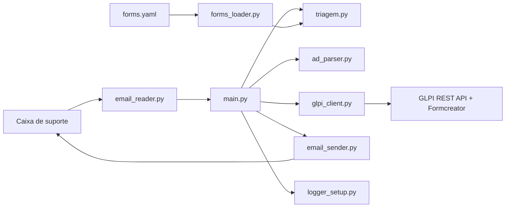

# Visão geral e componentes

## Propósito observado

O projeto automatiza a abertura de chamados de TI a partir de mensagens de suporte. O código integra caixa de e-mail Microsoft 365, classificação por regras/Gemini e GLPI com o plugin Formcreator. A confirmação ao solicitante é enviada após a criação do chamado.

## Componentes

O diagrama representa as chamadas e dependências verificadas no código, não limites de processos ou infraestrutura de deploy.

## Responsabilidades e dependências

- `main.py` coordena polling, validações, criação de chamado, confirmação e tratamento de erros.
- `email_reader.py` acessa IMAP, obtém token via MSAL, filtra remetentes e extrai o corpo da mensagem.
- `triagem.py` decide se a mensagem deve virar chamado e escolhe formulário/categoria; `forms_loader.py` lê `forms.yaml`.
- `ad_parser.py` interpreta o DN do usuário para obter nome, departamento e unidade.
- `glpi_client.py` usa `requests` para sessão, pesquisa de usuário, envio ao Formcreator e pós-processamento do ticket.
- `email_sender.py` envia a confirmação via SMTP; reutiliza `obter_access_token()` de `email_reader.py`.
- `config.py` concentra valores padrão e configuração via ambiente; `logger_setup.py` configura logging.

Detalhes por componente: [[02 - Modulos/Índice|Módulos]]. Sequência operacional: [[03 - Fluxos/Fluxo de processamento|fluxo de processamento]].

## Estado e persistência observados

Não há banco de dados ou camada de persistência estruturada no repositório. O cache do Gemini é mantido em memória; e-mails com erro de processamento podem ser serializados em JSON no diretório `emails_com_erro/`; logs são gravados em `bot.log` com rotação. Os diretórios/arquivos operacionais são criados durante a execução, não são módulos versionados.

Mais detalhes: [[04 - Dados/Índice|Dados e persistência]] e [[07 - Operacao/Índice|Operação]].

## Decisões documentadas no código

Não foi encontrado registro formal de ADRs. Os comentários e implementação evidenciam escolhas como polling IMAP a cada 30 segundos, limite do corpo do e-mail de 50.000 caracteres, filtro de domínios permitidos, classificação por palavras-chave antes de recorrer ao Gemini e uso dos formulários `manutencao` e `flexsmart`. Essas são escolhas observadas, não decisões formalizadas em documentação de arquitetura.

## Referências no repositório

- [`main.py`](../../../main.py) — `main()` e `processar_email()`.
- [`email_reader.py`](../../../email_reader.py) — `buscar_emails_novos()`.
- [`glpi_client.py`](../../../glpi_client.py) — `GLPIClient`.
- [`requirements.txt`](../../../requirements.txt) — dependências declaradas.

[[01 - Arquitetura/Índice|← Índice de Arquitetura]]
